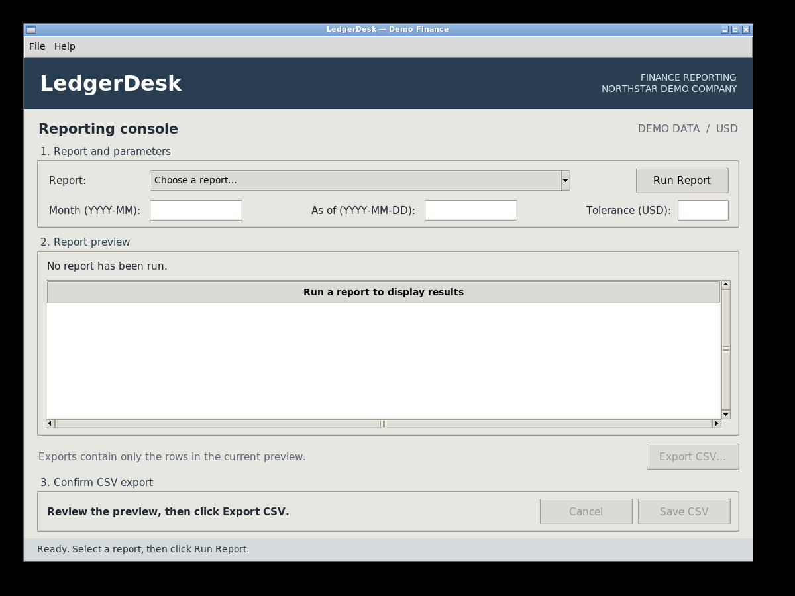

# LedgerDesk: computer use beyond the browser

A small Python demo of an OpenAI agent operating a fictional native finance application through screenshots, mouse clicks and keyboard input. The agent selects a report, enters its parameters, inspects the result and exports a CSV. A separate verifier checks the exported rows against the seeded records.

LedgerDesk is a real Tkinter desktop window inside an isolated Linux desktop. The browser viewer shows that desktop; it is not the application, and the agent receives no browser DOM or application API.

**Question:** When a business application has no usable integration, can an AI agent generate and export a correct report using only what a person sees on screen?

## Validation status

On 8 November 2026, **all 24 evaluated model runs produced independently verified CSVs**: eight attempts per task. This combines the original nine-run evaluation with 15 further attempts using the same model, fixture and desktop configuration.

| Task | Verified | Median elapsed | Estimated API cost, all 8 runs |
| --- | ---: | ---: | ---: |
| Monthly revenue | 8/8 | 26.717 s | USD 0.284688 |
| Overdue invoices | 8/8 | 26.415 s | USD 0.308254 |
| Reconciliation exceptions | 8/8 | 24.931 s | USD 0.285432 |

Across the 24 runs, median elapsed time was **25.740 seconds**, with **7–8 desktop actions** and **6–7 model requests** per run. Their combined standard-rate model API estimate was **USD 0.878374**, averaging **USD 0.036599 per run**. One similar task per workday would therefore be approximately **USD 0.73 for 20 workdays**, excluding desktop hosting. More complex workflows can use more model requests and cost more.

**[Read the article on henryhuysamen.com](https://www.henryhuysamen.com/writing/ledgerdesk-computer-use/)** · **[Open the 24-run evaluation](examples/evaluation-24/index.html)** · [Watch the narrated demo](examples/presentation/demo-narrated-v2.mp4) · [Inspect a standalone report](examples/evaluation-24/sample-report.html) · [Read the article](docs/article.md)

All 24 saved CSVs passed a separate recheck. **100 automated tests passed locally**. Configuration: `gpt-6.1-terra`, OpenAI Python SDK 3.31.0, macOS on Apple silicon, and a Linux arm64/X11 guest at 1200×900. See [validation details](docs/validation.md), [machine-readable results](examples/evaluation-24/summary.json), [cost calculations](examples/evaluation-24/cost-analysis.json) and [artifact hashes](examples/evaluation-24/manifest.json).

The [original nine-run package](examples/evaluation/index.html) remains unchanged. A separate successful pilot is retained but excluded from all 24-run statistics and monthly projections. Earlier setup blocks remain separate; costs are not inferred as zero when usage was unavailable.



## What the demo does

| Task | Required result |
| --- | --- |
| `monthly-revenue` | September 2026 net invoiced revenue by customer, descending, excluding voided invoices. |
| `overdue-invoices` | Outstanding invoice balances due before the supplied date, including partial payments. |
| `reconciliation-exceptions` | Transactions whose absolute recorded-versus-expected difference exceeds USD 0.01. |

All companies, invoices and transactions are synthetic. The seed contains 6 customers, 25 invoices and 9 reconciliation transactions. See [report semantics](docs/report-semantics.md) for exact definitions and edge cases.

## Quick start

Requirements: Python 3.11 or newer, Docker with Docker Compose v2, and an OpenAI API account with access to the configured computer-use model for agent runs. Opening and using the fixture manually does not require an API key.

The supported distribution is a source clone with an editable installation, so the Docker files remain available beside the Python package. From the repository root:

```bash
python3 -m venv .venv
source .venv/bin/activate
python -m pip install -e '.[dev]'
python -m ledgerdesk desktop
```

The first desktop start builds the Linux image and installs its GUI dependencies. Open the printed viewer URL:

<http://127.0.0.1:6080/vnc.html?autoconnect=true&resize=scale>

Try the app manually: choose a report, enter its parameters, click **Run Report**, then **Export CSV…** and **Save CSV**. The native window and its export confirmation remain inside the guest desktop.

The viewer is bound to localhost and intentionally has no authentication. It is for a trusted single user on the local machine; do not expose its port through a tunnel or public interface.

## Run the agent

Copy the configuration example and add your own API key locally:

```bash
cp .env.example .env
```

Keep `.env` private. The host runner reads it; the desktop container does not receive the key. The default model is `gpt-6.1-terra`; model access is checked by the actual API request, and an unavailable model is recorded as a blocked or failed attempt rather than replaced with a scripted demonstration.

```bash
python -m ledgerdesk run --task monthly-revenue
python -m ledgerdesk run --task overdue-invoices --as-of 2026-10-15
python -m ledgerdesk run --task reconciliation-exceptions
```

Each attempt starts a fresh seeded guest. Keep the viewer open to watch; avoid sending your own mouse or keyboard input during the run.

For explicit operating limits:

```bash
python -m ledgerdesk run \
  --task monthly-revenue \
  --model gpt-6.1-terra \
  --budget-usd 2 \
  --max-actions 40 \
  --max-requests 20 \
  --timeout 300
```

The budget is an estimated API-cost guard, not a provider billing cap. Standard rates were checked against [OpenAI pricing](https://developers.openai.com/api/docs/pricing) on 8 November 2026. The estimate applies those rates to reported input and output tokens; cache reads, cache writes and provider billing rules can change the actual charge. An in-flight request can complete after the estimate approaches its limit. The time limit is cooperative: an already-running desktop operation can take up to its 30-second transport timeout; subsequent actions are refused.

Every attempt produces a directory under `output/runs/`. Open its `report.html` to review the task, independent verification, CSV preview, captured screenshots, action trace, timing and available usage information. The HTML embeds its images and can be shared as one file after reviewing its contents.

To recheck an existing run and regenerate its evidence report:

```bash
python -m ledgerdesk verify --run-dir output/runs/<run-id>
```

To collect repeated attempts across the three tasks:

```bash
python -m ledgerdesk evaluate --repeats 3 --budget-usd 20
```

A run's budget applies to that attempt. The evaluation budget applies to the whole suite, with each attempt limited to the smaller of USD 2 or the estimated remaining suite budget.

A verified successful attempt establishes that the exported CSV was correct for that fixture and configuration. Repeated runs provide a small, visible sample; they do not establish general reliability across applications, operating systems or model versions. Preserve failed attempts when reporting results.

Stop the local desktop when finished:

```bash
python -m ledgerdesk stop
```

## How it is separated

```text
Host: task + OpenAI Responses API / ComputerToolset
                      │
           screenshots ↕ allowed mouse/keyboard actions
                      │
Guest: native LedgerDesk window → CSV export
                                      │
Host: independent CSV verifier ← copied export
                      │
             HTML report + event trace
```

- **Fixture:** Tkinter, SQLite and seeded business rules create the visible reports. The app deliberately has no report-export API for the agent.
- **Agent:** The configured OpenAI computer tool makes visual decisions. Its only computer actions go through the fixed desktop driver. It cannot query the database, inspect Tk widgets, read files, execute a shell or use the verifier.
- **Trusted controller:** Starts the guest, captures screenshots, executes allowed inputs, enforces limits and retrieves the exported file. Its fixed infrastructure commands are not model-selected tools.
- **Verifier:** Independently queries the seeded records and compares CSV columns, row count, values, ordering and uniqueness. It does not call the app's report-generation function. A model's completion message never counts as a pass.

The guest runs as a non-root user, without host bind mounts or API credentials, with a read-only container filesystem and temporary writable data. Its desktop network is configured as internal. Window identity and focus are checked before and after actions; out-of-window coordinates and unsupported actions or key combinations are rejected. These controls bound this demonstration to the included fixture.

One host process owns the desktop at a time; competing lifecycle commands fail rather than reset an active run. At startup the controller binds Tk's X11 window to the process it launched, because Tk does not supply that property itself. The agent cannot change that binding.

The viewer is only a way for a person to observe the native desktop. The agent does not control it with Playwright, Selenium or DOM selectors.

## Development and tests

```bash
python -m pytest
```

The deterministic tests require no API access. They cover fixture reset, reporting rules, CSV verification, export behavior, evidence rendering and applicable driver boundaries. A passing test suite is separate from live model validation.

GitHub Actions is configured to run these tests on Python 3.11 and 3.13, without an API key. Installing dependencies requires network access; the tests themselves use local data and mocked API responses.

The optional host-native fixture can be opened with:

```bash
python -m tkinter
python -m ledgerdesk fixture
```

This requires a Python installation with Tk support and a graphical session. It is for manual inspection. The supported agent path uses the isolated Linux desktop; direct macOS agent control is not claimed, and Windows support has not been validated.

## Troubleshooting

- **Docker cannot connect:** Start your Docker engine, then retry `python -m ledgerdesk desktop`. The first image build needs network access to download dependencies.
- **Docker subnet collision:** The demo uses `10.239.20.0/24` and `10.239.21.0/24` to avoid exhausting Docker's automatic address pools. Override `LEDGERDESK_DESKTOP_SUBNET` and `LEDGERDESK_VIEWER_SUBNET` in your shell if those ranges overlap local networks.
- **Viewer is blank:** Wait for the desktop health check to pass and refresh the viewer. Inspect `docker compose logs desktop viewer` if startup fails.
- **The run stops after a click or keypress:** Check the evidence trace. Closing the app, changing focus or sending unsupported inputs intentionally stops execution. Start a fresh attempt.
- **Authentication, model or quota error:** Check the local `.env`, your API account's model access and quota. Never paste the key into an issue or a saved report.
- **The model reports success but verification fails:** Treat the run as failed. Inspect the exported CSV and trace; do not substitute a deterministic export and label it an agent result.
- **The optional native fixture reports a Tk error:** Use the container desktop or a Python build with Tk support. Native host setup is not needed for the container agent path.

## Source map and references

`desktop_app.py` owns the fixture window and GUI export; `computer_agent.py` owns the model loop; `desktop_driver.py` and `guest_control.py` own the fixed transport and bounded inputs; `verify.py` owns the independent oracle; `html_report.py` renders saved evidence. `fixtures/seed.json` is the canonical synthetic dataset.

The implementation follows the current official [computer-use guide](https://developers.openai.com/api/docs/guides/tools-computer-use), [integration guide](https://developers.openai.com/api/docs/guides/tools-computer-use-integration) and [SDK driver guide](https://developers.openai.com/api/docs/guides/tools-computer-use-sdk-drivers). Recheck model availability and pricing before rerunning published examples.

Licensed under [MIT](LICENSE). Copyright © 2026 Henry Huysamen.
